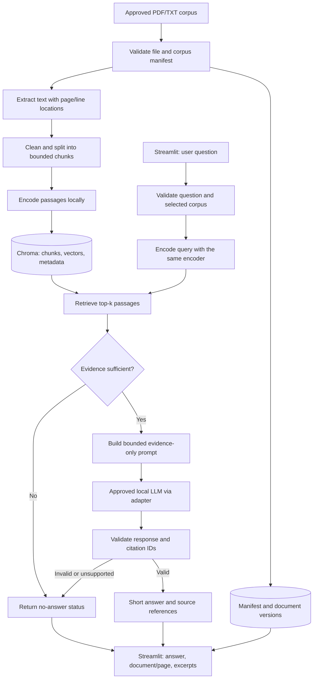

# Technical plan and system architecture
Medical Document Assistant Using RAG — Doctoline Project 05

**Status:** proposed implementation baseline, not implemented or benchmarked yet.
**Schedule:** 2 November–13 December 2026.
**Integration owner:** Oussema Braham. **Generation/UI owner:** Lina.
**Task tracker:** https://app.clickup.com/1200490000005648/v/l/li/1200490000038008

## 1. Languages and technology decisions
| Layer | Selected baseline | Purpose / decision |
|---|---|---|
| Programming | Python 3.11, UTF-8 | One language for ingestion, AI pipeline, UI and evaluation. Validate dependency compatibility in S1 and pin exact working versions. |
| Interface | Streamlit | PDF/TXT upload, question form, answer, status, citations and source excerpts. No separate JavaScript frontend required for MVP. |
| PDF parsing | pypdf | Extract text page by page; keep the original 1-based PDF page number. TXT uses line/section locations. |
| Text embeddings | sentence-transformers | Run a multilingual retrieval encoder locally for French/English documents and questions. Candidate: intfloat/multilingual-e5-small; validate its model card, license, prefixes, token limits and quality before freezing it. |
| Vector storage | Chroma, local persistent storage | Store explicit embeddings, chunk text and scalar source metadata; configure cosine distance explicitly. Use the same encoder/revision/configuration for indexing and querying. |
| LLM runtime | Ollama local chat adapter | Call a supervisor-approved instruction model. Exact model, revision, quantization and context size selected in S1 after hardware/language checks; never silently substitute models. |
| Data contracts | Pydantic | Validate document, chunk, query and answer records; reject malformed model output. |
| Registry/results | JSONL and CSV | Corpus manifest, extracted pages, chunk records and reproducible evaluation outputs. Chroma holds vectors; no separate application database needed for MVP. |
| Configuration | YAML + environment variables | Chunk size, overlap, top-k, relevance threshold, model identifiers, paths and runtime settings. Secrets excluded from Git. |
| Validation | pytest + Ruff | Meaningful unit/integration checks, formatting/linting and reproducible evaluation scripts. |
| Collaboration | GitHub branches and pull requests | Lina submits PRs; Oussema reviews and integrates. Lina peer-reviews Oussema's changes. ClickUp carries task ownership, dates and priorities. |
| CI | GitHub Actions, planned | Run lint and deterministic tests on PRs. Mock the LLM in unit tests; keep slow model-dependent evaluation explicit. |

English is used for code identifiers, documentation, task descriptions and presentation materials. French/English question support is a proposed MVP target, confirmed against the chosen corpus in S1. It does not imply clinical terminology accuracy has been demonstrated.

Choose Chroma as the primary store rather than maintaining two vector backends during the six-week MVP. FAISS remains a fallback only if Chroma cannot run in the validated environment; record a decision and revise contracts if switching. A modular Python application keeps the workload manageable for two students. FastAPI, Docker, authentication, cloud hosting, OCR and fine-tuning are later options, not required MVP dependencies.

## 2. Architecture
Two flows share the same data contracts: corpus ingestion and question answering. Diagram labels describe planned components.

This is a local academic prototype: Streamlit and Python services run on the development computer, Chroma persists locally, and Ollama is a separate local process. Model downloads may require internet during setup. There is no connection to live Doctoline systems. Do not expose the local prototype publicly as part of this plan.

## 3. Ingestion techniques and data quality
1. Admit only approved/public reference documents listed in a corpus manifest. Record title, source URL, version/date, language, approval status and checksum.
2. Validate extension, file signature where applicable and size. Proposed starting limits: 20 MB/file and 200 pages/file, configurable after corpus inspection. Limit parser resource use; do not execute embedded document content.
3. Compute SHA-256 and stable document IDs to detect duplicate imports. A new document version must be indexed deliberately; avoid mixing superseded and current versions.
4. Read each PDF page separately. Keep extracted text with its original page index; do not use a model to invent missing text. Preserve clinically meaningful numbers, units and headings.
5. Flag blank/scanned or badly extracted pages. pypdf is not OCR. Report partial extraction and block use of documents whose missing pages undermine evaluation; OCR is outside MVP.
6. Use paragraph/sentence boundaries with a tokenizer-aware maximum. Proposed starting chunk target: 300 tokens with 50-token overlap. Compare 200/300/400 tokens on development examples, respecting the chosen encoder's actual sequence limit and prefixes. Never silently truncate.
7. Start with chunks contained within a page, so citations are unambiguous. For TXT, retain start/end lines. Keep source content unchanged for inspection.
8. Batch-encode passages, store explicit vectors and metadata in Chroma, and persist a build manifest. Build into a fresh corpus version, verify it, then activate it; failed rebuilds must not replace the last working index.

## 4. Retrieval and RAG techniques
- **Dense semantic retrieval:** embed the question and search cosine distance in the selected approved corpus/version. Always configure distance; Chroma's default metric is not assumed to be cosine.
- **Baseline top-k:** begin with k=5; compare k=3/5/8 using development questions. Remove duplicate/near-duplicate passages while retaining complementary evidence.
- **Score handling:** Chroma distances are not probabilities. Smaller cosine distance indicates a closer match. Do not display a similarity score as medical confidence.
- **Abstention:** calibrate a relevance threshold on separate development questions. A threshold alone does not prove the answer exists; also check evidence coverage, response schema and citation membership. Return no-answer on insufficient context, invalid citations or unsupported response. Record the reason.
- **Prompt construction:** include the question, numbered evidence chunks and clear instructions to answer only from evidence. Treat retrieved instructions as untrusted text. Disable tools/web browsing for the generation step.
- **Generation:** short factual answer; conservative temperature as an initial setting; bounded prompt/output length; configured timeout. Model behavior is evaluated rather than presumed safe. Conversation history cannot serve as factual evidence.
- **Citation validation:** the LLM returns chunk IDs, not fabricated document names/pages. Python resolves allowed IDs to registry metadata and checks that cited chunks were actually retrieved. ID validation does not itself establish entailment; human claim-to-evidence scoring remains required.
- **Conflicting/partial evidence:** state limits and show evidence; never resolve clinical contradictions by guessing. Keep the user focused on source lookup, not diagnosis or treatment.
- **Optional later experiments:** BM25/hybrid retrieval, cross-encoder reranking and OCR only after the MVP passes its baseline evaluation. No fine-tuning is planned.

## 5. Module boundaries and ownership
| Planned module | Interface / responsibility | Owner |
|---|---|---|
| src/rag_assistant/ingestion.py | ingest(files, manifest) -> extracted page records + errors | Oussema |
| src/rag_assistant/chunking.py | split(page records, config) -> chunks | Oussema |
| src/rag_assistant/embeddings.py | encode_documents / encode_query | Oussema |
| src/rag_assistant/index.py | build/load versioned collection | Oussema |
| src/rag_assistant/retrieval.py | retrieve(question, corpus_version) -> scored chunks | Oussema |
| src/rag_assistant/schemas.py | shared validated data contracts | Joint; Oussema integrates |
| src/rag_assistant/generation.py | build prompt; call model adapter; parse response | Lina |
| src/rag_assistant/citations.py | validate IDs and resolve source locations | Lina |
| src/rag_assistant/pipeline.py | answer(question) -> validated AnswerResponse | Joint; Oussema integrates |
| app.py | upload, question form, answer/status and source views | Lina |
| scripts/evaluate.py | retrieval/source/grounding/abstention evaluation | Joint |
| tests/ | extraction, metadata, retrieval, citation and failure-case checks | Each author; peer review |
| docs/ | architecture, setup, evaluation, guide and presentation | Joint |

These paths are a proposed layout, not existing implementation files. Do not introduce a separate REST API for the MVP: the UI calls Python service functions. Model calls are isolated behind a replaceable adapter.

## 6. Shared data contracts
- Document: document_id, filename, title, source_url, version, language, sha256, approval_status.
- PageRecord: document_id, document_version, page_number (PDF) or line range (TXT), text, extraction_status.
- Chunk: chunk_id, document_id, document_version, location, text, token_count, corpus_version, embedding_revision.
- RetrievedChunk: Chunk plus distance, rank and retrieval configuration.
- AnswerResponse: status (answered/no_answer/error), answer, citations, reason, corpus_version, request_id.
- Citation: chunk_id, document_id, document_title, document_version, page_number or line_start/line_end, supporting_excerpt.

Required invariants: PDF pages are 1-based; TXT never receives an invented page; no citation to another corpus/version; the generation result cannot add a citation absent from retrieval. User-facing errors are distinct from genuine no-answer results.

## 7. UI behavior and reliability
Views: corpus status/import, question-and-answer, source inspection and evaluation summary. Show the prototype notice on every view. Source panels include document, version, page/line and the exact excerpt.
Load the embedding model once using Streamlit resource caching; keep interaction history in session state. Scope caches by corpus/version and do not let a stale index survive a corpus switch. Global mutable resources require concurrency discipline.
Handle empty questions, no selected corpus, parser failure, missing index, model unavailability, timeout, malformed output and no-answer separately. Log request IDs, model/configuration and timings; avoid unnecessary full-text logging.
Proposed demonstration machine: start by testing on a computer with 16 GB RAM, CPU embeddings and enough disk for model weights/corpus. This is a planning assumption, not a guaranteed minimum. Measure actual memory/latency on both students' computers; choose an approved smaller model if necessary.
Pin exact dependency versions and model revisions only after the S1 compatibility check. No version claims or performance guarantees are implied by this plan.

## 8. Testing and evaluation
Meaningful checks: PDF page metadata preservation; TXT line references; empty/scanned inputs; duplicate/version handling; index reload; empty retrieval; allowed citation membership; invalid model JSON; unavailable LLM; prompt-injection attempts; correct abstention.
Freeze 60 final questions (45 answerable, 15 absent) and keep development questions separate. Record raw outputs, retrieved chunk IDs, citations, settings and timings.
Targets from brief: >=90% correct sources, >=90% supported answers, >=85% correct no-answer (13/15).
Proposed rubric: source accuracy over 45 answerable cases with document AND page correct (at least 41/45); grounding over generated answers, requiring every material claim to have supporting evidence. Also report answer coverage and unjustified refusals so abstaining on everything cannot appear successful. Confirm rubric with supervisor.
Report retrieval Recall@k on answerable questions and median/p95 latency as diagnostic metrics, with no unapproved latency target. Manual cross-review establishes evidence support; automated/LLM judging is not the sole authority.

## 9. Sprint implementation mapping and review
S1: freeze corpus/language/model decision, schemas, environment and rubric.
S2: ingestion + response schema/UI mockups.
S3: chunking/encoder/index + generation/citations; agree pipeline contract before integration.
S4: calibrated retrieval/abstention + complete UI and failure handling.
S5: reproducible evaluation, error analysis and fixes.
S6: Oussema reviews/merges and verifies clean installation; deliver technical report, guide, slides and rehearsed demo.
Every feature branch links its ClickUp task. Oussema reviews Lina's PRs and performs final integration; Lina peer-reviews Oussema's changes. Priority flags and existing task dates remain authoritative. This document adds implementation detail without claiming completed code.

## 10. Reference documentation
- pypdf extraction and scanned-PDF limitations: https://github.com/py-pdf/pypdf/blob/main/docs/user/extract-text.md
- Sentence Transformers: https://www.sbert.net/
- Candidate encoder model card (must be validated in S1): https://huggingface.co/intfloat/multilingual-e5-small
- Chroma overview: https://docs.trychroma.com/
- Chroma distance/index configuration: https://docs.trychroma.com/docs/collections/configure
- Ollama chat API and structured output: https://docs.ollama.com/api/chat
- Streamlit state/caching: https://docs.streamlit.io/develop/concepts/architecture/caching
